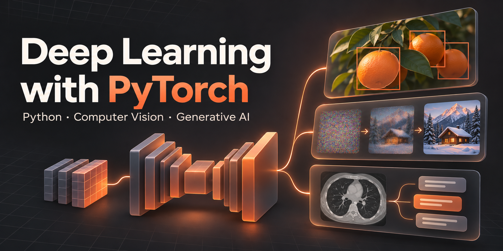

# Deep Learning with PyTorch

Supplementary material for the Master's course **Deep Learning with PyTorch**, offered by the **University of Ulm** in the **summer semester 2026**.

The course introduces neural networks, backpropagation, and loss functions. Its goal is to teach students to build, train, evaluate, and optimize models with PyTorch. These materials support the **Vision Track**, which covers CNNs, transformers, pre-training, detection, segmentation, vision-language models, image generation, and augmentation.

## Course contents

- [Python fundamentals](tutorials/01-python-fundamentals/) — Python syntax, NumPy, plotting, and image handling.
- [Object detection and segmentation](tutorials/02-object-detection-and-segmentation/) — Faster R-CNN, Mask R-CNN, and DETR.
- [Stable Diffusion XL](tutorials/03-stable-diffusion/) — text-to-image, image-to-image, LoRA adapters, and inference settings.
- [Vision-language inference with MedGemma](tutorials/04-medgemma/) — model access, multimodal prompts, and a small evaluation example.

## Quick start

If you are unfamiliar with Python, start with the [Python tutorial](tutorials/01-python-fundamentals/python_fundamentals.ipynb). It covers choosing an IDE, setting up a Python environment, and the language fundamentals used throughout the course.

Once you are comfortable with Python, choose one of the following options. Both use the same course materials and the shared [requirements.txt](requirements.txt) at the repository root.

### Option 1: Work on bwUniCluster

If you plan to use the high-performance computing cluster, complete the [bwUniCluster setup guide](setup/bwunicluster/) before continuing with the course materials. It walks you through obtaining access, transferring the course material, creating a Python environment, and configuring a Jupyter kernel. It also introduces submitting jobs with Slurm.

Once your cluster environment is ready, continue with the [course materials](#course-contents) through JupyterHub and select your course kernel. A GPU-backed session is recommended for Stable Diffusion and MedGemma.

### Option 2: Work on your own computer

If you do not plan to use the cluster, continue directly with the [course materials](#course-contents) on your own computer. You can refer back to the Python tutorial's setup section if you need help preparing your environment.

Install the shared course dependencies in your Python environment and select it as the kernel when opening the notebooks. The Python introduction can run on a CPU; the larger model demos benefit from a compatible GPU.

For either option, run each notebook from its own tutorial directory so that relative image paths and helper modules resolve correctly, and work through the cells in order.

## License

Course material is licensed under [Apache 2.0](LICENSE). External material retains its own terms; see [third-party notices](THIRD_PARTY_NOTICES.md).
